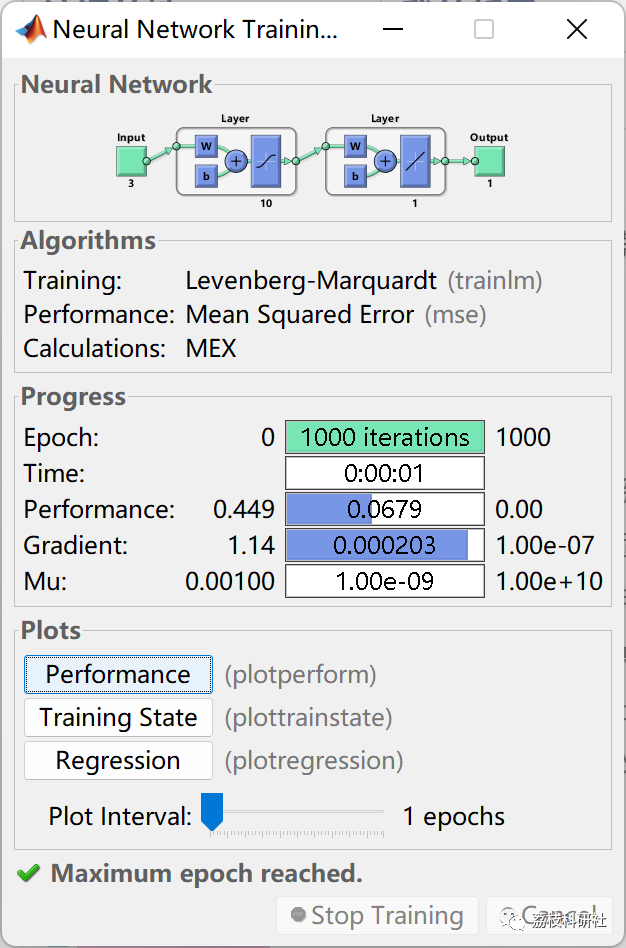
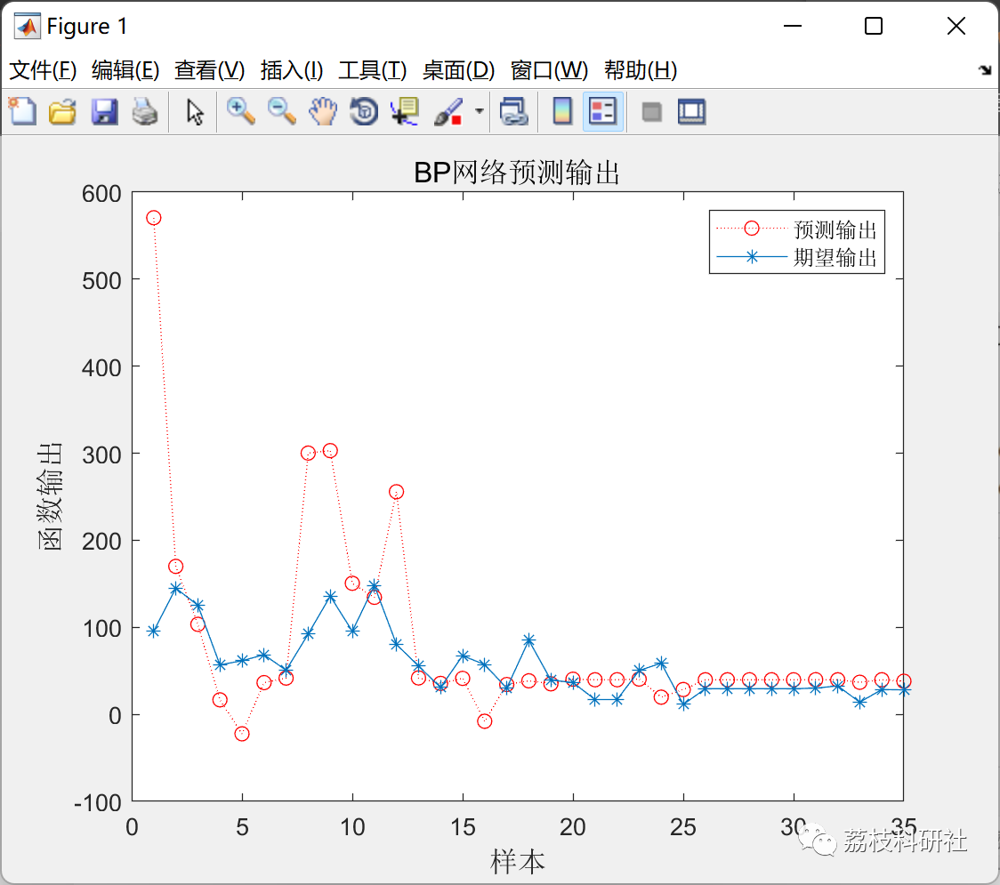
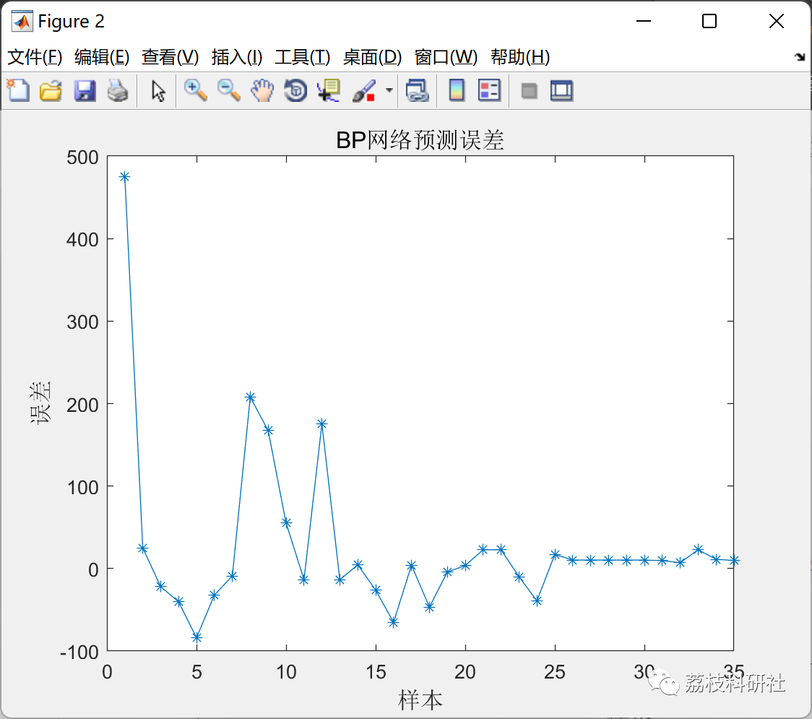
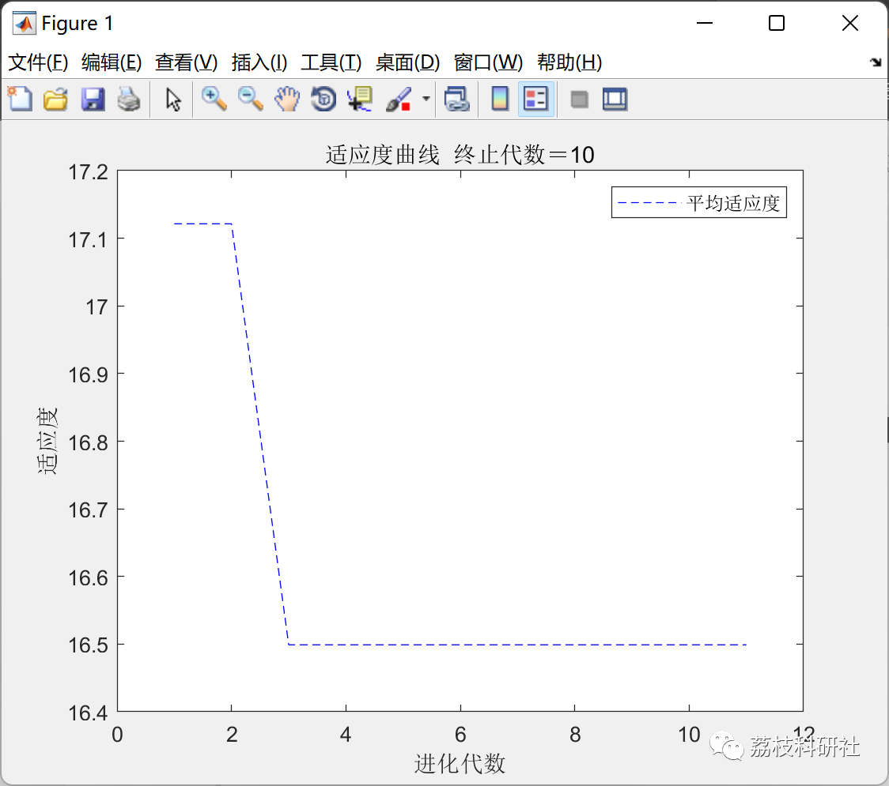
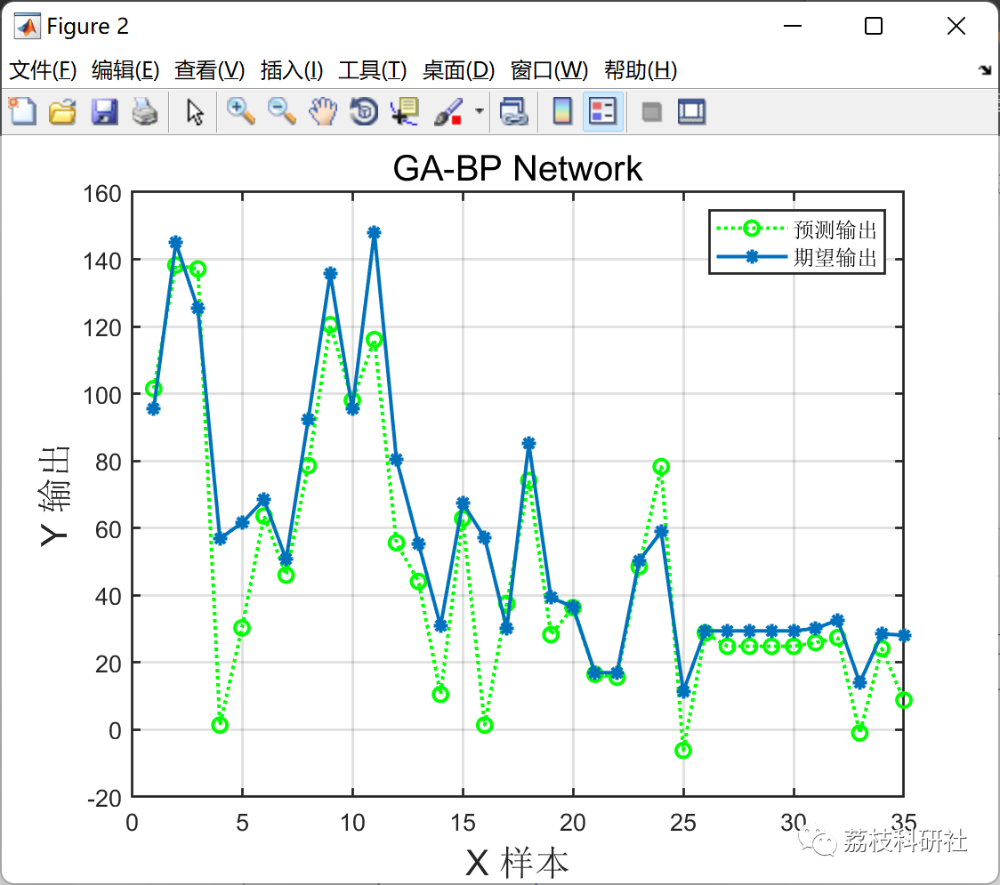
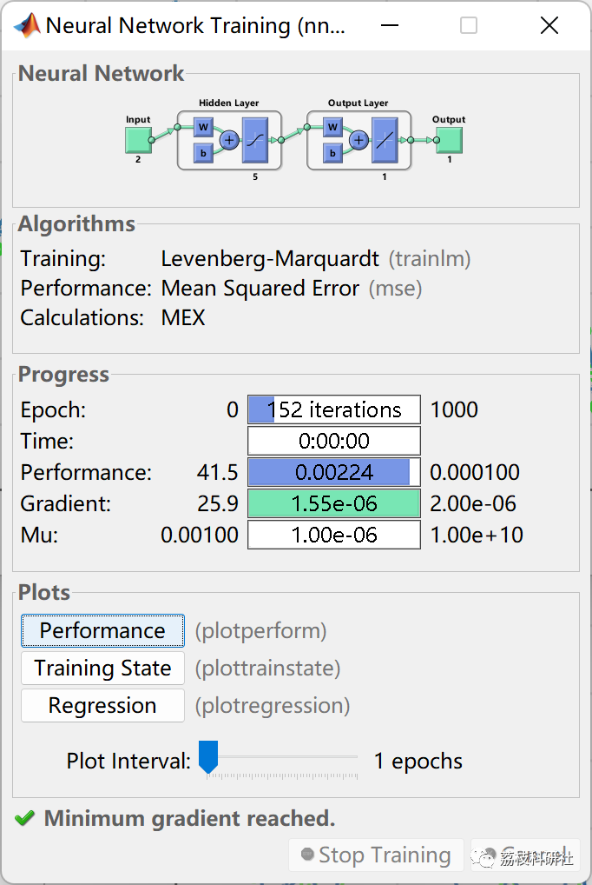
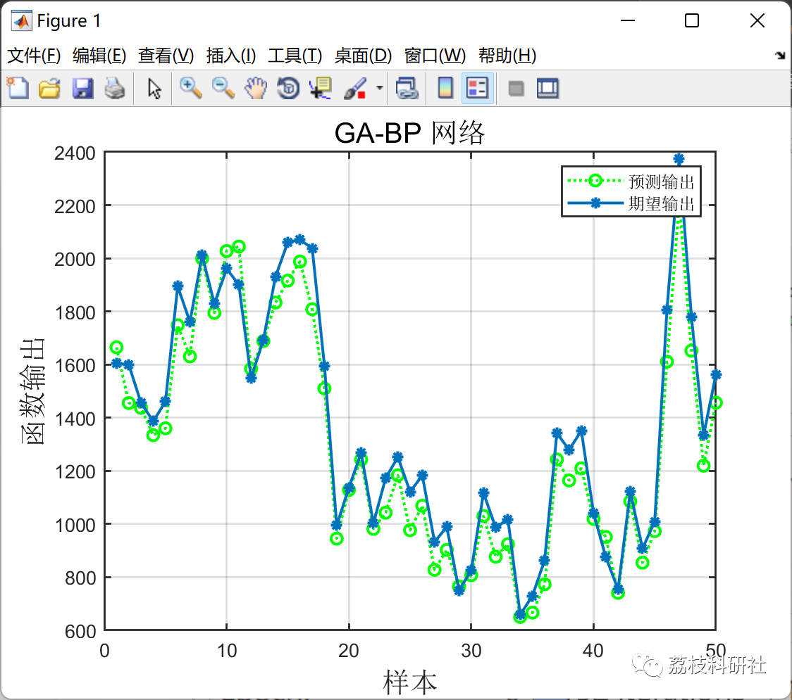

# Wind Power Forecasting Based on Improved Neural Network (Matlab Code Implementation)

💥💥💥💞💞💞💞 Welcome to this blog❤️❤️❤️💥💥💥
🏆 Bloggers' Advantage: 🌞🌞🌞 The content of the blog strives to be rigorous in thought and clear in logic, for the convenience of readers.
⛳️ Mantra: The journey of a hundred miles is half done in the last ninety.
Litchi Research Society
Code Collection: Power System, Intelligent Algorithms and Applications, Neural Network Prediction, Path Planning, Optimized Scheduling, Workshop Scheduling, Image Processing, Signal Processing...
🎁Column Directory Link:
🌈🌈🌈🌟🌟🌟Electrical Code Intelligent Algorithm and Its Application Path Planning Neural Network Predictive Optimization Scheduling Image Processing Workshop Scheduling Signal Processing Romantic Her My Philosophical Thoughts Math Modeling Complete Code Matters
Contents
💥1 Overview
📚2 Running Results
2.1 Initial BP Neural Network
2.2 GA-BP Neural Network
🎉3 References
🌈4 Matlab code implementation
💥1 Overview
The national economy's sustainable development requires the country to further deepen energy structure reforms and expand the scale of renewable energy. Wind power, as an important clean energy source, has developed rapidly in recent years. However, the inherent intermittency, randomness, and volatility of wind power pose challenges to the safe dispatching and smooth operation of large-scale wind power grid connections. Wind power power forecasting technology can predict the output power of wind turbines in the future period, providing effective basis for control personnel to ensure the stable operation of the power grid. It also helps reduce the cost of wind power generation and creates conditions for increasing the scale of wind power grid connection. Therefore, the prediction of wind power output is a key factor for the safe dispatching and smooth operation of the national power grid, and improving the accuracy of wind power power forecasting is of great significance.
📚2 Running Results
Initial BP Neural Network
GA-BP Neural Network:
🎉3 References
[1] Benefit. Research on wind power power prediction based on improved neural networks [D]. Nanjing Information Engineering University, 2020. DOI: 10.27248/d.cnki.gnjqc.2020.000066.
[2] Kou Jinchi. Design of Wind Power Power Forecasting System Based on Improved Neural Networks [D]. Shenyang Institute of Technology, 2021. DOI: 10.27845/d.cnki.gsygc.2021.000022.
[3] Liu Zengli, Yang Jing, Liu Yalin, Xiong Li. Short-term Wind Power Forecasting Based on Improved BP Neural Networks [J]. Ship Engineering, 2019, 41(S1): 282-287. DOI: 10.13788/j.cnki.cbgc.2019.S1.069.
🌈4 MATLAB Code for Realization
Click the left bottom corner of the article to read more.

## Images

<!-- PAYMENT_BLOCK -->

## Get this dataset

- Payment link (Stripe): [Buy now](https://buy.stripe.com/3cs8yP7sY87d0vu9AB)
- Payment QR code: 

<!-- /PAYMENT_BLOCK -->
